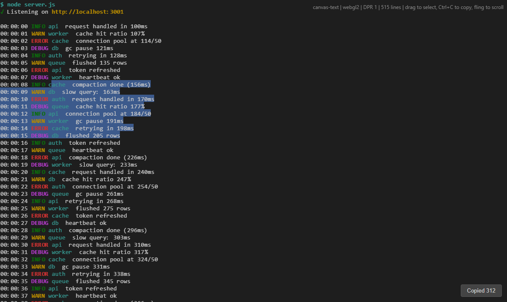
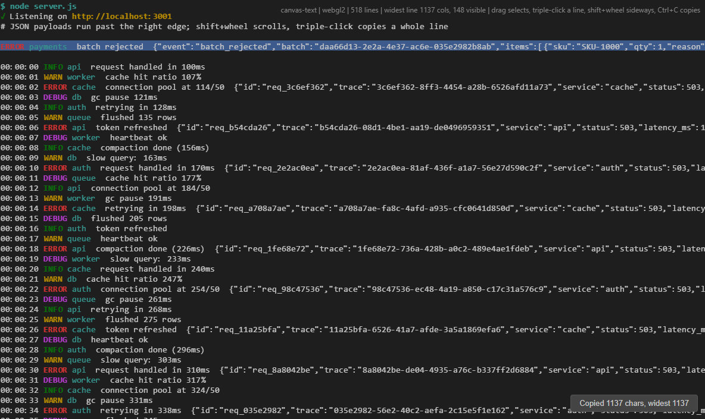
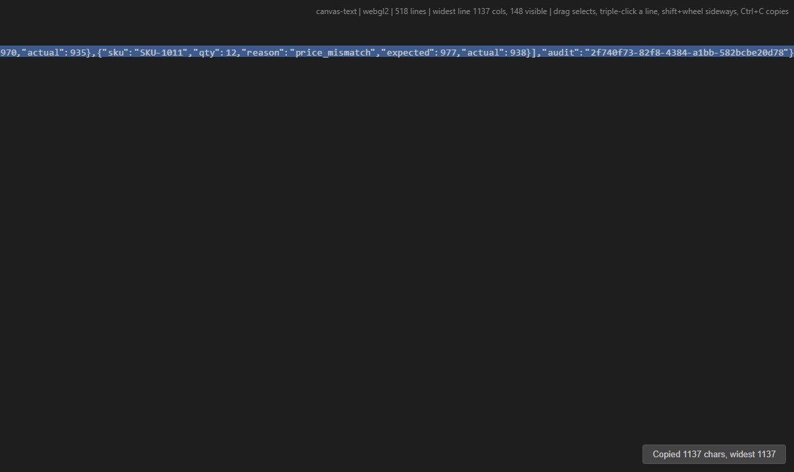

# Postmortem: mouse selection and copy did nothing

Status: fixed and verified in a real browser.

Reported symptom: *"I try select and see no visual change"* — dragging
the mouse over the text never highlighted anything, and the copy button
copied nothing.



Five separate defects were found. Only the first one was the reported
symptom; the other four were waiting behind it and would each have
produced a wrong result on their own.

---

## 1. The handlers were unbound methods (root cause)

`CanvasText` passed its prototype methods straight to
`addEventListener`:

```js
// src/view.js — before
init() {
	// ...
	this.canvas.addEventListener("pointerdown", this._onPointerDown)
	this.canvas.addEventListener("pointermove", this._onPointerMove)
	this.canvas.addEventListener("pointerup", this._onPointerUp)
	this.canvas.addEventListener("mousemove", this._onPointerMove)
}

_onPointerDown(e) {
	if (e.pointerType !== "mouse") return
	if (!this.metrics || !this.scroller) return   // ← always taken
	// ...
}
```

An event listener is not called as a method. The DOM calls it with
`this` set to the **target element**, so inside `_onPointerDown`,
`this` was the `<canvas>`, not the `CanvasText` instance. `this.metrics`
was `undefined` on an `HTMLCanvasElement`, so the guard returned on the
line above every single time. `selStart` was never assigned, `getSelection()`
always returned `null`, no rects were pushed, and nothing was drawn.

This is also why swapping `mousedown`/`mousemove` for
`pointerdown`/`pointermove` (the previous attempt) changed nothing: the
event names were never the problem.

The fix is to bind the handler to the instance. Class fields holding
arrow functions do that at construction:

```js
// src/view.js — after
_onPointerDown = (e) => {
	// Touch drags scroll; only the mouse selects.
	if (e.pointerType !== "mouse" || e.button !== 0) return
	if (!this.metrics || !this.scroller) return   // now the instance
	// ...
}
```

A comment records why the shape matters, since it is invisible at the
call site:

```js
// These are arrow properties, not methods: addEventListener calls a
// listener with `this` bound to the target, so a plain method would
// lose the instance.
```

`ScrollController` already used bound arrows (`this.onDown = (e) => this.pointerDown(e)`),
which is exactly why fling scrolling worked while selection silently did
not — a useful clue: one listener set worked, the other did not.

### Confirming it

The guard made the failure completely silent, so the diagnosis was
checked by experiment rather than by reading the code. In a live page the
listener was swapped for the old shape — a plain function registered with
`addEventListener` — and a real mouse drag was dispatched over the
DevTools protocol. The handler recorded what `this` had become:

```js
function oldDown(e) {
	window.__log.push({handlerThis: this.constructor.name, hasMetrics: !!this.metrics})
	if (e.pointerType !== "mouse") return
	if (!this.metrics || !this.scroller) return
	this.selStart = {line: 0, col: 0}
}
canvas.addEventListener("pointerdown", oldDown)
```

Then the bound arrow was restored and the same drag repeated. One run,
both states:

| Listener shape      | `this`              | `this.metrics` | `selStart`      | rects |
| ------------------- | ------------------- | -------------- | --------------- | ----- |
| `obj.method` (old)  | `HTMLCanvasElement` | absent         | `null`          | 0     |
| arrow field (fixed) | `CanvasText`        | present        | line 11, col 15 | 5     |

The `HTMLCanvasElement` row is the whole bug: the handler did run, and
returned on the guard above, which is why nothing appeared and no error
was logged. The fixed row is the same drag, with 199 characters selected
across 5 rows — one rect per row, so the instances really reached the GPU
pass rather than stopping at the JS layer.

---

## 2. Selection geometry measured the raw line, not the visible text

With selection working, the highlight overshot the end of every row by
about 28 cells.

`Scene` kept only the raw lines, and those still contain the ANSI escape
sequences that colour the text. Those bytes occupy no screen columns, but
they do inflate `String.length`:

```js
// src/scene.js — before
let line = this.lines[row]
if (line == null) continue
let colStart = 0, colEnd = line.length      // counts \x1b[2m etc.
```

A 44-column log line was 72 characters long, so the background rect was
72 cells wide. The row that ended the selection looked correct because
its end column came from the pointer, not from `line.length` — which is
what made the pattern look like a "last row is fine" bug rather than a
length bug.

`Scene` now owns a plain projection built once in `setText`:

```js
// src/scene.js — after
setText(text) {
	this.lines = text.split("\n")
	this.plain = this.lines.map(line => expandTabs(stripAnsi(line)).replace(/\r/g, ""))
	this.version++
}
```

and selection geometry reads it:

```js
// src/scene.js — after
let line = this.plain[row]
```

The glyph loop below still uses `this.lines`, because it needs the
styling to choose colours and font variants.

---

## 3. Copied text contained the escape sequences

`getSelectedText()` sliced the same raw lines, so a copy pasted
`\x1b[2m00:00:08\x1b[0m…` instead of the visible text, and every column
after the first ANSI run was offset.

Two helpers were added to `src/ansi.js`. `stripAnsi` removes escapes
without allocating a run list, and returns the input unchanged when there
is nothing to strip:

```js
export function stripAnsi(text) {
	if (text.indexOf("\x1b") < 0) return text
	let out = ""
	let i = 0
	while (i < text.length) {
		let ch = text[i]
		if (ch === "\x1b") {
			if (i + 1 < text.length && text[i + 1] === "[") {
				let j = i + 2
				while (j < text.length && ((text[j] >= "0" && text[j] <= "9") || text[j] === ";")) j++
				if (j < text.length && text[j] === "m") {
					i = j + 1
					continue
				}
			}
			i++
			continue
		}
		out += ch
		i++
	}
	return out
}
```

`expandTabs` handles the second half of the same problem. The grid draws
a tab by advancing to the next multiple of 8 columns, so one `\t`
character occupies several cells; without expansion, one visual column
stops indexing the right character:

```js
export function expandTabs(text) {
	if (text.indexOf("\t") < 0) return text
	let out = ""
	let col = 0
	for (let ch of text) {
		if (ch === "\t") {
			let n = 8 - (col % 8)
			out += " ".repeat(n)
			col += n
		} else {
			out += ch
			col++
		}
	}
	return out
}
```

After both, **a visual column is a string index** for every line, and the
whole selection model reduces to `slice`. `getSelectedText()` now reads
the plain projection:

```js
let text = this._plain[line] ?? ""
```

Copying a line wider than the canvas therefore returns the whole line,
not the visible part, because the range is resolved against the document
rather than against pixels.

---

## 4. Horizontal scroll was applied twice (latent)

`render()` handed the scene the scroller's `scrollLeft` in CSS pixels,
but `Scene.build()` documents its `scrollX` argument as being in cells
and multiplies by the cell width:

```js
// src/view.js — before
let scrollX = this.scroller.scrollLeft        // px, not cells
this.scene.build(firstRow, lastRow, scrollX, sel, this.selectionColor)
let offsetX = -scrollX * m.cellWidth          // px² — wrong twice over
```

This was invisible while `scrollLeft` was 0, which is why it survived:
selection looked right at the default scroll position and no demo line
was ever wide enough to scroll sideways.

The unit was fixed first (`scrollX = this.scroller.scrollLeft / m.cellWidth`),
and the page still went **blank** the moment it was scrolled right. The
unit was not the real problem. The real problem was that there were two
coordinate spaces for one axis:

- `Scene.build()` positioned every instance at `(col - scrollX) * cellW`
  — viewport space.
- The pass offset was `-scrollX * m.cellWidth` — which subtracts the
  scroll a *second* time.

Vertical had no such split (`y = row * lh`, offset `-scrollTop`), so only
the horizontal axis cancelled itself out. The fix is to delete the
duplicate space rather than convert between them: the scene lays out in
content space on both axes, and the pass offsets are the only place
scrolling happens.

```js
// src/scene.js — after
build(firstRow, lastRow, selection, selectionColor) {
	// ...
	let x = colStart * cellW
	let w = (colEnd - colStart) * cellW
	pushRect(rbuf, x, row * lh, w, lh, selColor)
	// ...
	let x = col * cellW
```

```js
// src/view.js — after
this.scene.build(firstRow, lastRow, sel, this.selectionColor)
// Instances are laid out in content space; the pass offsets are
// the only place scrolling is applied, for both axes.
let offsetX = -this.scroller.scrollLeft
let offsetY = -scrollY
```

`Scene.build()` no longer takes `scrollX` at all, so the conversion that
caused the original unit bug cannot come back.

This was found only because the demo gained lines wider than the window:
until then `scrollLeft` was pinned at 0 and the bug was unobservable.

---

## 5. A drag that left the canvas stopped working

Two gaps remained in the interaction itself.

Listeners lived on the canvas, so dragging onto the scrollbar, out of the
window, or past the bottom edge stopped extending the selection, and a
button released outside the canvas never ended the drag. The move and up
listeners are now attached to the window for the duration of a drag:

```js
// src/view.js — after
_onPointerDown = (e) => {
	if (e.pointerType !== "mouse" || e.button !== 0) return
	if (!this.metrics || !this.scroller) return
	let pos = this._posToLineColClient(e.clientX, e.clientY)
	this.selStart = pos
	this.selEnd = pos
	this._selecting = true
	this._pointerX = e.clientX
	this._pointerY = e.clientY
	// Track on the window: a drag that leaves the canvas keeps
	// extending the selection and still sees the button release.
	window.addEventListener("pointermove", this._onPointerMove)
	window.addEventListener("pointerup", this._onPointerUp)
	e.preventDefault()
	this._needsRender = true
}
```

Holding the pointer past an edge now scrolls and grows the selection, the
way native selection does:

```js
_autoScroll = () => {
	this._autoRaf = 0
	if (!this._selecting || !this.scroller) return
	let rect = this.canvas.getBoundingClientRect()
	let up = this._pointerY < rect.top ? this._pointerY - rect.top : 0
	let down = this._pointerY > rect.bottom ? this._pointerY - rect.bottom : 0
	let left = this._pointerX < rect.left ? this._pointerX - rect.left : 0
	let right = this._pointerX > rect.right ? this._pointerX - rect.right : 0
	let dy = up || down, dx = left || right
	if (!dy && !dx) return
	// Faster the further out the pointer is, capped so a stray
	// pointer far off-screen cannot teleport the view.
	let speed = (d) => Math.min(60, Math.max(2, Math.abs(d) * 0.5))
	this.scroller.scrollTop += Math.sign(dy) * speed(dy)
	this.scroller.scrollLeft += Math.sign(dx) * speed(dx)
	this.scroller.clamp()
	this.selEnd = this._posToLineColClient(this._pointerX, this._pointerY)
	this._needsRender = true
	this._autoRaf = requestAnimationFrame(this._autoScroll)
}
```

The loop reschedules only while the pointer is actually outside an edge,
so it costs nothing during an ordinary drag.

---

## Edge cases pinned down along the way

Positions clamp to real text, so a drag into empty space cannot create a
range past the document:

```js
// src/view.js — after
line = Math.max(0, line)
col = Math.max(0, col)
// Past the last line the position is that line's end, and past
// the end of a line it is the line's end, so a drag that leaves
// the text does not overshoot.
if (this._plain.length && line > this._plain.length - 1) line = this._plain.length - 1
let text = this._plain[line]
if (text != null && col > text.length) col = text.length
```

A selection crossing a line break has to show the newline, including on
empty lines, which have no width of their own:

```js
// src/scene.js — after
let colStart = row === selection.startLine ? selection.startCol : 0
let colEnd = row === selection.endLine ? selection.endCol : line.length
colStart = Math.max(0, Math.min(colStart, line.length))
colEnd = Math.max(0, Math.min(colEnd, line.length))
if (colEnd <= colStart) {
	if (row === selection.endLine) continue
	colStart = line.length
	colEnd = line.length + 1      // one cell for the newline
}
```

A plain click collapses the range (`selStart === selEnd`), so
`colEnd <= colStart` and the row draws nothing — a click deselects, as
expected in a text view.

---

## Verification

Reading the code was not enough here: the failure was silent, so the fix
was checked by driving a real browser. Headless Chrome was started with
`--remote-debugging-port`, a WebSocket spoke CDP to it, and
`Input.dispatchMouseEvent` produced genuine mouse events (which the
browser turns into pointer events, exactly as a user would).

| Case                  | Expected                     | Observed                                              |
| --------------------- | ---------------------------- | ----------------------------------------------------- |
| single click          | nothing selected             | `getSelectedText() === ""`, 0 rects                   |
| drag rows 11→18       | one rect per row             | 8 rects, 312 chars                                    |
| drag past bottom edge | auto-scroll, selection grows | scrolled to line 462, 44 rects, 17424 chars copied    |
| Copy button click     | clipboard receives the text  | label `Copied 312`, `writeText` got exactly that text |

Selected text, copied from a window whose lines are 35–45 columns wide:

```
ache  compaction done (156ms)
00:00:09 WARN db  slow query: 163ms
00:00:10 ERROR auth  request handled in 170ms
00:00:11 DEBUG queue  cache hit ratio 177%
00:00:12 INFO api  connection pool at 184/50
00:00:13 WARN worker  gc pause 191ms
00:00:14 ERROR cache  retrying in 198ms
00:00:15 DEBUG db  flushed 205 rows
```

The first line is a partial line (the drag started mid-word at column 15)
and the last ends mid-line; every line between comes back whole. The
screenshot at the top of this file is the same drag, with the highlight
ending exactly where each line's text ends.

### Lines wider than the window

No line in the original fixture was wide enough to scroll sideways, so
the horizontal path had never been exercised. The fixture now contains
payloads — a JSON body on every error line, one 1137-column JSON dump at
the top — so clipping and copying can be compared directly.



| Measurement                              | Value                                                                |
| ---------------------------------------- | -------------------------------------------------------------------- |
| Lines in the demo                        | 518                                                                  |
| Visible columns                          | 148                                                                  |
| Widest line                              | 1137 columns                                                         |
| Lines wider than the window              | 126                                                                  |
| `maxScrollLeft`                          | 7912 px                                                              |
| Triple-click on the widest line          | selects 1137 of 1137 chars                                           |
| Clipboard after that triple-click        | 1137 chars, identical to the document line, ends with `"audit":"…"}` |
| Render cost with the wide rows on screen | 0.23 ms/frame                                                        |

Copying therefore returns the whole line even though the screen shows
only its first 148 columns, which is the behaviour being tested: the
range is resolved against the text, not against what is visible.

Scrolling fully right shows the tail of that line, and the selection
highlight moves with it because both are in content space:



`bun run check` passes, and the bundle was rebuilt.

---

## What to take from this

- **A listener passed as `obj.method` loses `obj`.** `this` becomes the
  element. It fails silently — the handler runs and returns. Bind it, or
  use an arrow field, and never rely on a guard clause inside the handler
  to reveal it.
- **When two event sets share a surface and only one works**, compare how
  they are registered before suspecting the event names. `ScrollController`'s
  bound handlers working was the strongest signal that the events were
  fine.
- **A unit that only works at 0 is not tested.** `scrollX` in pixels
  equals cells only when it is zero.
- **Two offsets for one axis cancel each other.** Fixing the pixel/cell
  unit made horizontal scrolling *blank* rather than wrong, because the
  scene and the pass offset both subtracted the scroll. Scrolling belongs
  in one place; positions are content space, offsets are the only
  translation.
- **Test data decides what bugs are reachable.** Horizontal scrolling was
  broken the whole time and looked fine, because no fixture line was
  wider than the window. Add the adversarial case before believing the
  feature works.
- **Rendering and copying must read the same text model.** The moment the
  draw path used raw ANSI lines and the copy path used the same string,
  both were wrong in different ways. A single plain projection, owned by
  the scene and shared with the view, keeps them consistent.
- **Verify from outside the process** when the failure mode is "nothing
  happens": read back the state, then the buffer counts, then the pixels.
